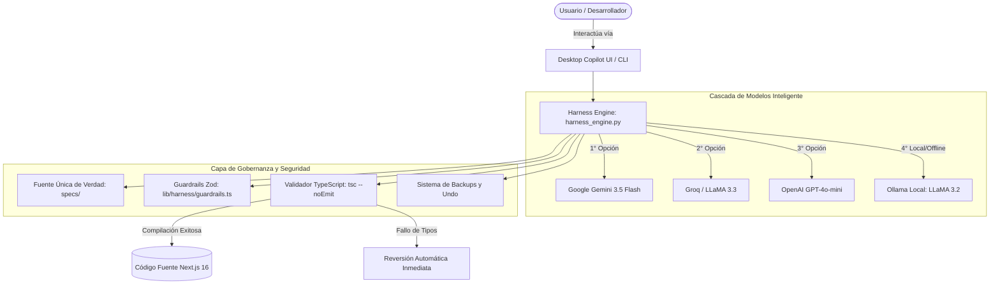

# Manual de Usuario — Itiers AI Harness & Copilot 🛡️🤖

> **Itiers Data Sense — Plataforma Web Corporativa (Pasantías 2026)**  
> **Arquitectura y Arnés de IA:** Stefano Ferro (Practicante 3 — Harness & AI Engineering)  
> **Versión:** 2.0 (Suite de Gobernanza, Auditoría QA/GEO y Copilot de Escritorio)

---

## 📑 Tabla de Contenidos

1. [¿Qué es el AI Harness de Itiers?](#1-qué-es-el-ai-harness-de-itiers)
2. [Arquitectura y Principios de Funcionamiento](#2-arquitectura-y-principios-de-funcionamiento)
3. [Requisitos Previos e Instalación Rápida](#3-requisitos-previos-e-instalación-rápida)
4. [Configuración de Proveedores de IA y Claves API](#4-configuración-de-proveedores-de-ia-y-claves-api)
5. [Modos de Uso del Arnés](#5-modos-de-uso-del-arnés)
   * [Modo 1: Interfaz Gráfica de Escritorio (Itiers Copilot UI)](#modo-1-interfaz-gráfica-de-escritorio-itiers-copilot-ui)
   * [Modo 2: Consola Interactiva (CLI)](<#modo-2-consola-interactiva-cli>)
   * [Modo 3: Scripts Automatizados y Pipelines CI/CD](#modo-3-scripts-automatizados-y-pipelines-cicd)
   * [Modo 4: Guardrails de Validación en Código (Zod)](#modo-4-guardrails-de-validación-en-código-zod)
6. [Catálogo de Comandos y Atajos](#6-catálogo-de-comandos-y-atajos)
7. [Buenas Prácticas y Cumplimiento de Reglas (AGENTS.md)](#7-buenas-prácticas-y-cumplimiento-de-reglas-agentsmd)
8. [Resolución de Problemas Frecuentes (Troubleshooting)](#8-resolución-de-problemas-frecuentes-troubleshooting)

---

## 1. ¿Qué es el AI Harness de Itiers?

El **AI Harness (Arnés de Inteligencia Artificial)** es la capa de gobernanza, ingeniería y control que rodea a los modelos de lenguaje (LLMs) dentro del proyecto de Itiers Data Sense. Se basa en el principio fundacional:

$$\text{Agente} = \text{Modelo de Lenguaje (LLM)} + \text{Harness (Arnés de Control)}$$

Mientras que un modelo por sí solo puede cometer alucinaciones o degradar el código, el **Harness** actúa como un marco de contención que:
* **Valida cada cambio con TypeScript (`tsc --noEmit`)**: Si una sugerencia de código rompe los tipos o la compilación, se descarta automáticamente.
* **Crea respaldos instantáneos y permite deshacer cambios (Undo)** en 1 clic.
* **Audita accesibilidad WCAG AA, SEO y GEO (Generative Engine Optimization)** frente a las especificaciones formales (`specs/`).
* **Aplica Guardrails estrictos** mediante esquemas Zod en formularios, enlaces a WhatsApp y metadatos JSON-LD.
* **Garantiza la regla estricta de Cero Lorem Ipsum**.

---

## 2. Arquitectura y Principios de Funcionamiento



### Características Principales
1. **Cascada de Modelos Multimodal**: Si una API falla por límite de cuota o falta de conexión, conmuta automáticamente a la siguiente opción sin interrumpir al usuario.
2. **Modo 100% Local / Offline**: Funciona completamente sin internet conectándose a una instancia local de **Ollama** (`llama3.2`).
3. **Auto-Reparación Asistida**: Analiza componentes, detecta elementos interactivos sin accesibilidad y genera código correctivo sin tocar la lógica de negocio.

---

## 3. Requisitos Previos e Instalación Rápida

### Requisitos del Sistema
* **Node.js**: v18.x o superior.
* **Python**: v3.10 o superior (recomendado 3.11 o 3.12).
* **Sistema Operativo**: Windows, macOS o Linux.

### Pasos de Instalación

1. **Instalar dependencias de Node.js:**
   ```bash
   npm install
   ```

2. **Instalar dependencias de Python del Harness:**
   ```bash
   pip install -r requirements.txt
   ```
   *(Instala `google-genai` y `openai`).*

3. **Verificar que la suite esté lista:**
   ```bash
   npm run verify:harness
   ```

---

## 4. Configuración de Proveedores de IA y Claves API

El Harness busca automáticamente las variables de entorno en el archivo `.env.local` ubicado en la raíz del proyecto.

1. **Crear o editar `.env.local`:**
   ```env
   # Proveedor Principal: Google Gemini (Recomendado)
   GEMINI_API_KEY=tu_clave_api_gemini_aqui

   # Proveedor Secundario: Groq (Opcional, ultra rápido)
   GROQ_API_KEY=tu_clave_api_groq_aqui

   # Proveedor Alternativo: OpenAI (Opcional)
   OPENAI_API_KEY=tu_clave_api_openai_aqui
   ```

2. **Uso Local / Gratuito con Ollama (Sin claves API):**
   * Descarga e instala [Ollama](https://ollama.com/).
   * En tu terminal ejecuta:
     ```bash
     ollama run llama3.2
     ```
   * El Harness detectará automáticamente Ollama activo en `http://localhost:11434`.

---

## 5. Modos de Uso del Arnés

### Modo 1: Interfaz Gráfica de Escritorio (Itiers Copilot UI)

Es la forma más cómoda e intuitiva de trabajar, orientada a desarrolladores y revisores de código.

#### ¿Cómo iniciar el Copilot?
* **En Windows**: Haz doble clic en el acceso directo **`Iniciar-Itiers-Copilot.bat`** (o en `Iniciar-Itiers-Copilot.vbs` para modo ventana sin consola negra).
* **Vía npm**:
  ```bash
  npm run copilot
  ```
* **Vía Python directamente**:
  ```bash
  python itiers_copilot.py
  ```

Se abrirá automáticamente en tu navegador predeterminado la dirección:
`http://localhost:8765`

#### Panel y Herramientas Visuales del Copilot:
1. **Selector de Componentes:** Lista desplegable en la barra lateral con todos los archivos `.tsx` de `components/` y `app/`.
2. **🔍 Botón Auditar QA:** Realiza un diagnóstico inmediato del componente seleccionado en busca de contrastes, atributos semánticos, etiquetas HTML5 y directivas WCAG AA.
3. **🛠️ Botón Auto-Reparar:** Instruye al agente para corregir las observaciones del componente. El arnés valida el cambio con TypeScript antes de aplicarlo.
4. **↩️ Deshacer Último Cambio (Undo):** Si el resultado no es el esperado, este botón restaura inmediatamente la copia de seguridad previa con 1 clic.
5. **Alternador de Ollama:** Permite forzar el uso de modelos locales con 1 clic para trabajar desconectado o sin consumir cuota de API.
6. **Chat Conversacional:** Área de chat interactiva donde puedes solicitar modificaciones en lenguaje natural (ej. *"Asegura contraste de color en Hero.tsx y agrega focus ring a los botones"*).

---

### Modo 2: Consola Interactiva (CLI)

Ideal para desarrolladores que prefieren trabajar dentro de la terminal de VS Code o PowerShell.

#### ¿Cómo iniciar la CLI?
```bash
python harness_engine.py
```

Al iniciar, se presentará el banner interactivo de Itiers:
```text
=============================================================================
🛡️ ITIERS AI AGENT HARNESS — CONSOLA INTERACTIVA MULTIMODELO
=============================================================================
Modelo activo: gemini-3.5-flash (Google AI)
Escribe tu consulta o usa comandos con '/' (ej: /auditar, /reparar, /ayuda, /salir)
=============================================================================
Itiers-Harness>
```

#### Comandos CLI Disponibles:
* `/auditar components/ServiceCard.tsx`: Audita accesibilidad, semántica y estándares de un archivo específico.
* `/reparar components/ServiceCard.tsx`: Corrige problemas detectados con verificación estricta de compilación.
* `/deshacer`: Revierte el último archivo modificado.
* `/geo`: Ejecuta una auditoría GEO/SEO de visibilidad y metadatos de las páginas de la aplicación.
* `/sdd`: Verifica el estado de tareas y requerimientos frente a `specs/`.
* `/modelos`: Muestra la lista de modelos configurados, latencias y estado de conexión.
* `/ollama`: Conmuta entre proveedores en la nube y modelos locales de Ollama.
* `/limpiar`: Limpia el historial de la conversación.
* `/salir`: Cierra la consola del arnés.

---

### Modo 3: Scripts Automatizados y Pipelines CI/CD

El arnés se integra de forma nativa con el ciclo de vida de desarrollo (`npm scripts`):

| Comando | Acción del Arnés | Uso Recomendado |
| :--- | :--- | :--- |
| `npm run verify:harness` | Ejecuta la auditoría estricta de TypeScript (`tsc --noEmit`), chequea ausencia total de *Lorem Ipsum* y valida que existan los esquemas Zod. | **Obligatorio** antes de hacer commit o push. |
| `npm run harness:sdd` | Ejecuta `sdd_harness.py` verificando la coherencia del código contra `specs/`. | Integrado automáticamente en `npm run build`. |
| `npm run harness:qa` | Ejecuta `harness_qa.py` auditando integralmente todos los componentes clave. | Revisiones periódicas de calidad de código. |
| `npm run harness:recommender` | Ejecuta `recommender_harness.py` para generar diagnósticos y sugerencias arquitectónicas. | Sesiones de refactorización y optimización. |
| `npm run copilot` | Levanta el servidor local de la interfaz gráfica de escritorio. | Desarrollo diario asistido. |

---

### Modo 4: Guardrails de Validación en Código (Zod)

El archivo [lib/harness/guardrails.ts](file:///d:/Totti/FACULTAD/itiers-web/lib/harness/guardrails.ts) define los contratos formales de datos que protegen la aplicación contra ingresos inválidos o ataques de inyección:

1. **`LeadContactSchema`**: Valida formularios de contacto corporativos (nombres sanitizados, emails válidos, mensajes de longitud controlada).
2. **`WhatsAppChannelSchema`**: Valida que los números de WhatsApp tengan formato internacional E.164 (`549261...`) y que los mensajes predeterminados estén codificados y libres de scripts maliciosos.
3. **`JsonLdSchema`**: Garantiza que el esquema semántico de Schema.org contenga todos los campos obligatorios para las 3 sedes (Argentina, Chile, EE. UU.).
4. **`ServicePackageSchema`**: Valida la integridad estructural de las tarjetas y catálogos de servicio.

---

## 6. Catálogo de Comandos y Atajos

| Acción Deseada | Método Rápido |
| :--- | :--- |
| **Abrir Copilot en Windows** | Doble clic en `Iniciar-Itiers-Copilot.bat` |
| **Abrir Copilot vía Terminal** | `npm run copilot` |
| **Auditar todo el proyecto** | `npm run harness:qa` |
| **Chequear tipos y Lorem Ipsum** | `npm run verify:harness` |
| **Compilar producción con validación previa** | `npm run build` |
| **Deshacer último cambio del agente** | Clic en **↩️ Deshacer** en Copilot o escribir `/deshacer` en CLI |

---

## 7. Buenas Prácticas y Cumplimiento de Reglas (AGENTS.md)

Al utilizar el Harness o solicitarle modificaciones de código, se aplican automáticamente las reglas de oro del repositorio:

1. **Fuente de Verdad Única**: Toda generación debe ceñirse a las especificaciones en `specs/` (`requirements.md`, `design.md`, `i18n.md`, `tasks.md`).
2. **Cero Lorem Ipsum**: Queda terminantemente prohibido incorporar textos de relleno o maquetas ficticias.
3. **Cero Parches Superficiales**: No tragar excepciones ni devolver fallbacks vacíos. Toda corrección resuelve la causa raíz comprobada.
4. **Accesibilidad WCAG AA Obligatoria**: Contraste suficiente, estados de foco visual (`focus:ring-2`), semántica HTML5 y navegación por teclado.
5. **Validación con Guardrails Zod**: Ningún dato ingresa o egresa sin pasar por los esquemas tipados de `lib/harness/guardrails.ts`.
6. **Compilación Limpia**: Cada edición se somete a `npx tsc --noEmit`. Si no compila limpiamente, no se aplica.

---

## 8. Resolución de Problemas Frecuentes (Troubleshooting)

### Problema 1: *"Falta clave API de Gemini/Groq"*
* **Solución**: Abre o crea el archivo `.env.local` en la raíz y define `GEMINI_API_KEY=tu_clave`. Si no posees una clave, puedes utilizar Ollama en modo local o el arnés activará el modo de fallback informativo.

### Problema 2: *"No se puede ejecutar python o pip"*
* **Solución**: Asegúrate de que Python 3.10+ esté instalado y marcado en la casilla *"Add python.exe to PATH"* durante su instalación en Windows.

### Problema 3: *"Un cambio del agente rompió un estilo o diseño"*
* **Solución**: 
  * Desde la interfaz de Copilot: Haz clic en el botón naranja **`↩️ Deshacer Último Cambio`**.
  * Desde la CLI: Escribe `/deshacer`.
  * Desde Git: Ejecuta `git restore <archivo>`.

### Problema 4: *"El puerto 8765 ya está en uso al iniciar el Copilot"*
* **Solución**: Cierra cualquier ventana previa de `Iniciar-Itiers-Copilot.bat` o mata el proceso de Python que esté escuchando en dicho puerto.

---

<p align="center">
  <b>Itiers Data Sense — AI Harness & Copilot Suite</b><br>
  <i>Gobernanza, Calidad Continua y Desarrollo Guiado por Especificaciones (SDD)</i><br>
  © 2026 Itiers Data Sense. Todos los derechos reservados.
</p>

