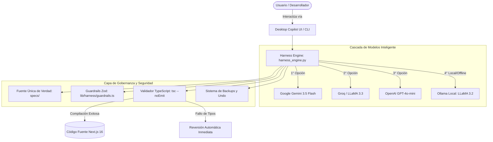

# Manual de Usuario — Itiers AI Harness & Copilot

> **Itiers Data Sense — Plataforma Web Corporativa (Pasantías 2026)**  
> **Arquitectura y Arnés de IA:** Stefano Ferro (Practicante 3 — Harness & AI Engineering)  
> **Versión:** 2.1 (Suite de Gobernanza, Modos de Operación y Configuración `.env.local`)

---

## Tabla de Contenidos

1. [¿Qué es el AI Harness de Itiers?](#1-qué-es-el-ai-harness-de-itiers)
2. [Arquitectura y Principios de Funcionamiento](#2-arquitectura-y-principios-de-funcionamiento)
3. [Requisitos Previos e Instalación Rápida](#3-requisitos-previos-e-instalación-rápida)
4. [Configuración de Proveedores de IA y Claves API (.env.local)](#4-configuración-de-proveedores-de-ia-y-claves-api-envlocal)
5. [Modos de Operación: Consulta vs. Edición](#5-modos-de-operación-consulta-vs-edición)
6. [Modos de Uso del Arnés](#6-modos-de-uso-del-arnés)
   * [Modo 1: Interfaz Gráfica de Escritorio (Itiers Copilot UI)](#modo-1-interfaz-gráfica-de-escritorio-itiers-copilot-ui)
   * [Modo 2: Consola Interactiva (CLI)](#modo-2-consola-interactiva-cli)
   * [Modo 3: Scripts Automatizados y Pipelines CI/CD](#modo-3-scripts-automatizados-y-pipelines-cicd)
   * [Modo 4: Guardrails de Validación en Código (Zod)](#modo-4-guardrails-de-validación-en-código-zod)
7. [Catálogo de Comandos y Atajos](#7-catálogo-de-comandos-y-atajos)
8. [Buenas Prácticas y Cumplimiento de Reglas (AGENTS.md)](#8-buenas-prácticas-y-cumplimiento-de-reglas-agentsmd)
9. [Resolución de Problemas Frecuentes (Troubleshooting)](#9-resolución-de-problemas-frecuentes-troubleshooting)

---

## 1. ¿Qué es el AI Harness de Itiers?

El **AI Harness (Arnés de Inteligencia Artificial)** es la capa de gobernanza, ingeniería y control que rodea a los modelos de lenguaje (LLMs) dentro del proyecto de Itiers Data Sense. Se basa en el principio fundacional:

$$\text{Agente} = \text{Modelo de Lenguaje (LLM)} + \text{Harness (Arnés de Control)}$$

Mientras que un modelo por sí solo puede cometer alucinaciones o degradar el código, el **Harness** actúa como un marco de contención que:
* **Valida cada cambio con TypeScript (`npx tsc --noEmit`)**: Si una sugerencia de código rompe los tipos o la compilación, se realiza un rollback automático.
* **Crea respaldos instantáneos y permite deshacer cambios (Undo)** en 1 clic o mediante comando.
* **Audita accesibilidad WCAG AA, SEO y GEO (Generative Engine Optimization)** frente a las especificaciones formales (`specs/`).
* **Aplica Guardrails estrictos** mediante esquemas Zod en formularios, enlaces a WhatsApp y metadatos JSON-LD.
* **Garantiza la regla estricta de Cero Lorem Ipsum**.

---

## 2. Arquitectura y Principios de Funcionamiento



### Características Principales
1. **Cascada de Modelos Multimodal**: Si una API falla por límite de cuota o falta de conexión, conmuta automáticamente a la siguiente opción sin interrumpir al usuario.
2. **Modo 100% Local / Offline**: Funciona completamente sin internet conectándose a una instancia local de **Ollama** (`llama3.2`).
3. **Auto-Reparación Asistida**: Analiza componentes, detecta elementos interactivos sin accesibilidad y genera código correctivo sin tocar la lógica de negocio.

---

## 3. Requisitos Previos e Instalación Rápida

### Requisitos del Sistema
* **Node.js**: v18.x o superior.
* **Python**: v3.10 o superior (recomendado 3.11 o 3.12).
* **Sistema Operativo**: Windows, macOS o Linux.

### Pasos de Instalación

1. **Instalar dependencias de Node.js:**
   ```bash
   npm install
   ```

2. **Instalar dependencias de Python del Harness:**
   ```bash
   pip install -r requirements.txt
   ```

3. **Verificar que la suite esté lista:**
   ```bash
   npm run verify:harness
   ```

---

## 4. Configuración de Proveedores de IA y Claves API (.env.local)

El Harness gestiona la seguridad y configuración de credenciales únicamente mediante el archivo `.env.local` ubicado en la raíz del proyecto.

1. **Crear o editar `.env.local`:**
   ```env
   # Proveedor Principal: Google Gemini (Recomendado)
   GEMINI_API_KEY=tu_clave_api_gemini_aqui

   # Proveedor Secundario: Groq (Opcional, ultra rápido)
   GROQ_API_KEY=tu_clave_api_groq_aqui

   # Proveedor Alternativo: OpenAI (Opcional)
   OPENAI_API_KEY=tu_clave_api_openai_aqui
   ```

2. **Uso Local / Gratuito con Ollama (Sin claves API):**
   * Descarga e instala [Ollama](https://ollama.com/).
   * En tu terminal ejecuta:
     ```bash
     ollama run llama3.2
     ```
   * El Harness detectará automáticamente Ollama activo en `http://localhost:11434` o al presionar el botón **/ollama** en la UI.

---

## 5. Modos de Operación: Consulta vs. Edición

Para garantizar seguridad y un control estricto sobre el repositorio, la plataforma cuenta con límites claros entre modos:

1. **Modo Consulta (Sólo Lectura):**
   * **Propósito:** Inspección y análisis seguro de archivos.
   * **Comportamiento:** Lee automáticamente el archivo o carpeta seleccionados en la UI y responde consultas técnicas o contextuales sobre el código.
   * **Seguridad:** Bloquea preventivamente cualquier intento accidental de modificar archivos en disco.

2. **Modo Edición (Escritura Activa):**
   * **Propósito:** Creación y modificación de componentes y código.
   * **Comportamiento:** Aplica cambios solicitados directamente sobre los archivos en disco, guardándolos automáticamente.
   * **Gobernanza:** Ejecuta una validación técnica con `npx tsc --noEmit`. Si el código no compila limpiamente, realiza un rollback de seguridad automático y permite restaurar la versión anterior en 1 clic.

---

## 6. Modos de Uso del Arnés

### Modo 1: Interfaz Gráfica de Escritorio (Itiers Copilot UI)

Es la forma principal e intuitiva de trabajar para desarrolladores y supervisores de QA.

#### ¿Cómo iniciar el Copilot?
* **Vía npm**:
  ```bash
  npm run copilot
  ```
* **Vía Python directamente**:
  ```bash
  python itiers_copilot.py
  ```

Se abrirá automáticamente en tu navegador la dirección: `http://localhost:8765`

#### Panel y Herramientas Visuales del Copilot:
1. **Selector de Objetivo:** Permite seleccionar archivos o carpetas del proyecto mediante el explorador visual.
2. **Interruptor de Modo:** Toggle claro para alternar entre **Modo Consulta** (análisis seguro) y **Modo Edición** (modificación activa).
3. **Control del Servidor Dev:** Botón en la barra superior para iniciar o detener el servidor local de Next.js (`http://localhost:3000`).
4. **↩️ Deshacer Último Cambio (Undo):** Restaura de inmediato el respaldo anterior si un cambio no es el deseado.
5. **Alternar /ollama:** Conmuta al instante entre el uso de modelos en la nube (.env.local) y modelos locales.

---

### Modo 2: Consola Interactiva (CLI)

Ideal para desarrolladores que trabajan directamente en la terminal.

#### ¿Cómo iniciar la CLI?
```bash
python harness_engine.py
```

#### Comandos CLI Disponibles:
* `/auditar [filepath]`: Audita accesibilidad, semántica y estándares de un archivo.
* `/reparar <filepath>`: Corrige problemas detectados con verificación de compilación.
* `/deshacer [filepath]`: Revierte el último archivo modificado.
* `/geo [filepath]`: Audita visibilidad SEO/GEO de las páginas.
* `/sdd`: Verifica tareas y requerimientos frente a `specs/`.
* `/modelos`: Muestra la prioridad y estado de modelos configurados.
* `/ollama`: Conmuta entre nube y Ollama local.
* `/salir`: Cierra la consola.

---

### Modo 3: Scripts Automatizados y Pipelines CI/CD

| Comando | Acción del Arnés | Uso Recomendado |
| :--- | :--- | :--- |
| `npm run verify:harness` | Audita TypeScript (`tsc --noEmit`), ausencia de *Lorem Ipsum* y esquemas Zod. | Pre-commit / Pre-push. |
| `npm run harness:sdd` | Verifica la coherencia del código contra `specs/`. | Integrado en `npm run build`. |
| `npm run harness:qa` | Ejecuta la auditoría integral de calidad en componentes. | Revisiones de QA. |
| `npm run harness:recommender` | Genera recomendaciones arquitectónicas y estratégicas. | Sesiones de refactorización. |
| `npm run copilot` | Levanta el servidor local de la interfaz gráfica (`localhost:8765`). | Desarrollo diario. |

---

### Modo 4: Guardrails de Validación en Código (Zod)

El archivo `lib/harness/guardrails.ts` define los contratos de datos que protegen la aplicación:

1. **`LeadContactSchema`**: Valida formularios de contacto corporativos (nombres sanitizados, emails válidos, mensajes de longitud controlada).
2. **`WhatsAppChannelSchema`**: Valida que los números tengan formato internacional E.164 y sanitiza los mensajes predeterminados.
3. **`JsonLdSchema`**: Garantiza que el marcado estructurado contenga todos los campos obligatorios para las sedes oficiales.
4. **`ServicePackageSchema`**: Valida la integridad de las tarjetas y servicios.

---

## 7. Catálogo de Comandos y Atajos

| Acción Deseada | Método Rápido |
| :--- | :--- |
| **Abrir Copilot UI** | `npm run copilot` o `python itiers_copilot.py` |
| **Auditar todo el proyecto** | `npm run harness:qa` |
| **Chequear tipos y Lorem Ipsum** | `npm run verify:harness` |
| **Compilar producción con validación previa** | `npm run build` |
| **Deshacer último cambio** | Escribir *deshacer* o presionar **/deshacer** |

---

## 8. Buenas Prácticas y Cumplimiento de Reglas (AGENTS.md)

1. **Fuente de Verdad Única**: Toda generación debe ceñirse a `specs/` (`requirements.md`, `design.md`, `i18n.md`, `tasks.md`).
2. **Cero Lorem Ipsum**: Queda terminantemente prohibido incorporar textos ficticios.
3. **Cero Parches Superficiales**: No tragar excepciones ni usar fallbacks vacíos sin solucionar la causa raíz.
4. **Accesibilidad WCAG AA Obligatoria**: Contraste suficiente, foco visible (`focus:ring-2`) y navegación por teclado.
5. **Validación con Guardrails Zod**: Ningún dato crítico ingresa o egresa sin pasar por `lib/harness/guardrails.ts`.
6. **Compilación Limpia**: Cada edición debe superar `npx tsc --noEmit`.

---

## 9. Resolución de Problemas Frecuentes (Troubleshooting)

### Problema 1: *"Sin API Key / Modo Standby"*
* **Solución**: Asegúrate de haber creado el archivo `.env.local` en la raíz con tu variable `GEMINI_API_KEY=tu_clave`. Alternativamente, inicia Ollama localmente para trabajar 100% offline.

### Problema 2: *"El Copilot no modifica archivos"*
* **Solución**: Verifica que el interruptor de la parte superior esté en **Modo Edición ACTIVO** (color naranja). En Modo Consulta el sistema opera únicamente en modo lectura.

### Problema 3: *"Un cambio rompió el código"*
* **Solución**: Haz clic en el botón de deshacer o escribe *deshacer* en el chat para restaurar la copia previa automáticamente.

---

<p align="center">
  <b>Itiers Data Sense — AI Harness & Copilot Suite</b><br>
  <i>Gobernanza, Calidad Continua y Desarrollo Guiado por Especificaciones (SDD)</i><br>
  © 2026 Itiers Data Sense. Todos los derechos reservados.
</p>